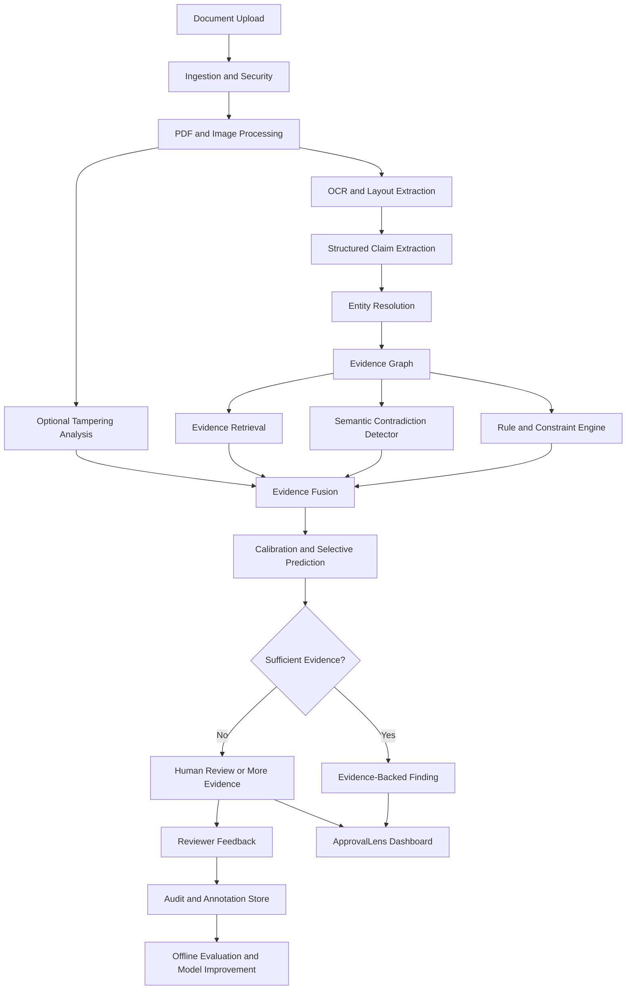

# ApprovalLens AI — Master Technical Build Specification

**Version:** 1.0  
**Project type:** Research-driven AI document verification and evidence intelligence platform  
**Primary stack:** Python, FastAPI, PyTorch, PostgreSQL, Redis, Next.js  
**Development philosophy:** Evidence-first, measurable, modular, uncertainty-aware, reproducible  
**Target:** A technically defensible, high-performance hackathon demonstration with a credible path toward research publication

---

## 1. Project Vision

ApprovalLens AI will evolve from a document approval and compliance workflow into an **evidence intelligence system** that verifies claims across multiple documents, identifies contradictions, explains its findings, quantifies uncertainty, and determines when a human reviewer is required.

The system should answer five questions:

1. What information does each document claim?
2. Where exactly did each extracted claim come from?
3. Do the documents agree with one another and with applicable rules?
4. How reliable is each conclusion, and what evidence supports it?
5. What additional evidence would most efficiently resolve an uncertain case?

The defining feature will be a structured, auditable evidence model rather than an LLM generating an unsupported verdict.

### Example scenario

An applicant submits three documents:

- Identity document: date of birth is 14 May 2002.
- Application form: date of birth is 14 May 2002.
- Supporting certificate: date of birth is 14 May 2003.

ApprovalLens should:

1. Extract each date.
2. Link each extracted value to its source document, page, and text region.
3. Determine whether the documents refer to the same person and field.
4. Identify the disagreement.
5. Check extraction confidence and image quality.
6. Display the contradictory evidence side by side.
7. Recommend the next verification action.
8. Preserve the complete review and correction history.

The system must not automatically conclude that the applicant committed fraud. A contradiction is evidence requiring investigation, not proof of intent.

---

## 2. Research Objectives

We will develop the project around four testable research questions.

### RQ1 — Cross-document reasoning

Does structured evidence-graph reasoning improve contradiction detection over independent document checks and conventional rule-based verification?

**Hypothesis:** Explicit relationships between claims, documents, entities, and rules will improve detection of multi-document inconsistencies.

### RQ2 — Uncertainty-aware verification

Can calibrated confidence and selective prediction reduce false alarms without missing an unacceptable number of critical discrepancies?

**Hypothesis:** A system that can abstain and request review will provide a better precision–coverage trade-off than one forced to make a binary decision for every case.

### RQ3 — Multimodal evidence fusion

Does combining textual, visual, structural, and metadata signals improve verification compared with using each signal independently?

**Hypothesis:** Multiple independent evidence sources can improve robustness, provided their dependencies and failure modes are handled correctly.

### RQ4 — Evidence-efficient review

Can the system select the next most useful verification action to reduce uncertainty and human review time?

**Hypothesis:** An evidence acquisition strategy based on uncertainty reduction and decision impact can outperform a fixed review checklist.

These are hypotheses, not established results. The experiments will determine which are supported.

---

## 3. System Architecture

The system will retain the existing full-stack application as the foundation. We will introduce a modular Python verification engine behind the existing FastAPI service and connect it to the current database, processing jobs, and frontend.

### High-level architecture



### Architectural principles

- Every finding must reference its supporting evidence.
- Every model output must conform to a validated schema.
- The rule engine must remain independently testable.
- Unavailable models must not silently produce fabricated results.
- Every prediction must be reproducible from recorded inputs, versions, and configuration.
- The UI must distinguish confirmed discrepancies, possible discrepancies, missing information, and inconclusive evidence.
- The core verification pipeline must work without requiring multiple autonomous LLM agents.

---

## 4. Agent and Model Design

We will implement agents as bounded, testable modules. An agent may use an ML model, deterministic code, or a combination of both. We will not assume that every module requires an LLM.

### Agent 1 — Document Intake and Quality Agent

**Purpose:** Safely ingest files and determine whether they are suitable for processing.

**Inputs**
- PDF, PNG, JPEG, or supported document format.
- File metadata and document identifier.

**Responsibilities**
- Validate MIME type and file signatures.
- Enforce file-size and page-count limits.
- Compute a SHA-256 content hash.
- Detect encrypted, malformed, or suspicious files.
- Convert pages to normalized images.
- Detect skew, blur, low contrast, and insufficient resolution.
- Record the quality of every page.

**Technologies**
- Python
- PyMuPDF
- Pillow
- OpenCV
- `hashlib`
- Pydantic

**Output**

```json
{
  "document_id": "doc_001",
  "sha256": "example_hash",
  "page_count": 3,
  "quality": {
    "blur_score": 0.18,
    "skew_degrees": 1.2,
    "resolution_adequate": true
  },
  "status": "ready_for_extraction"
}
```

The numerical values above are illustrative.

**Tests**
- Corrupt PDFs.
- Oversized files.
- Duplicate files.
- Rotated and blurred pages.
- Malicious or malformed uploads.

---

### Agent 2 — OCR and Layout Agent

**Purpose:** Convert pages into text and spatially grounded evidence.

**Candidate models**
- Tesseract as an accessible baseline.
- PaddleOCR as a practical OCR candidate.
- TrOCR for selected recognition experiments.
- Layout-aware models such as LayoutLMv3 for relevant structured extraction tasks.
- OCR-free document models such as Donut for controlled comparisons.

These are alternatives to benchmark, not components that all need to run on every request.

**Output requirements**
- Extracted text.
- Page number.
- Bounding boxes.
- Token or region confidence when available.
- Table and field regions where supported.
- Model and preprocessing version.

**Research experiment**

Compare OCR and layout alternatives on:
- Character error rate.
- Word error rate.
- Field extraction accuracy.
- Source-region localization accuracy.
- Latency and resource use.

The selected model should be the best practical fit for the target documents, not simply the newest or largest model.

---

### Agent 3 — Structured Claim Extraction Agent

**Purpose:** Transform document content into normalized, evidence-linked claims.

Example claim:

```json
{
  "claim_id": "claim_001",
  "document_id": "doc_001",
  "field": "date_of_birth",
  "raw_value": "14/05/2002",
  "normalized_value": "2002-05-14",
  "source_page": 1,
  "source_bbox": [110, 240, 280, 275],
  "extraction_method": "ocr_plus_structured_parser",
  "confidence": null
}
```

`confidence: null` means that no calibrated confidence is available. We must not invent a probability.

**Candidate methods**
1. Regex and deterministic parsers.
2. Schema-constrained LLM extraction.
3. Layout-aware token classification.
4. Vision-language document extraction.
5. An ensemble of independent extractors, if its additional value is demonstrated.

**Required behavior**
- Preserve the original text.
- Normalize values without deleting the original representation.
- Track ambiguous values.
- Reject malformed structured outputs.
- Link every claim to a source region whenever available.
- Distinguish missing information from a negative finding.

**Tests**
- Dates with ambiguous formats.
- Names with transliteration differences.
- Missing fields.
- Multiple candidate values on one page.
- Incorrect OCR characters.
- Hallucinated fields.
- Output schema violations.

---

### Agent 4 — Entity Resolution Agent

**Purpose:** Determine whether different documents refer to the same entity.

For example, two records may contain spelling variations of a name while sharing a date of birth and an identification number.

**Candidate methods**
- Exact matching.
- Normalized string matching.
- RapidFuzz similarity.
- Probabilistic record linkage.
- Learned pairwise similarity models.

**Output**

```json
{
  "entity_pair": ["claim_001", "claim_014"],
  "same_entity_probability": null,
  "matching_features": [
    "same_identifier",
    "similar_name",
    "same_date_of_birth"
  ],
  "status": "requires_resolution"
}
```

Probabilities will only be emitted after a model has been trained and calibrated.

**Important safeguard:** Do not merge records solely because their names are similar. A mistaken entity merge can manufacture false contradictions.

**Evaluation**
- Pairwise precision and recall.
- False-merge rate.
- False-split rate.
- Performance on transliteration and spelling variations.

---

### Agent 5 — Evidence Graph Builder

**Purpose:** Represent claims and their relationships in a structured graph.

The graph is the central data model of the research system.

**Node types**
- Document.
- Page.
- Extracted claim.
- Entity.
- Requirement or rule.
- Evidence region.
- Verification finding.
- Reviewer action.

**Edge types**
- `EXTRACTED_FROM`
- `REFERS_TO`
- `SUPPORTS`
- `CONTRADICTS`
- `DERIVED_FROM`
- `REQUIRES`
- `SUPERSEDES`
- `REVIEWED_BY`

Example:

```text
Document A
    |
    +-- EXTRACTED_FROM --> DOB = 2002-05-14
                                  |
                                  +-- REFERS_TO --> Applicant 1
                                  |
                                  +-- CONTRADICTS --> DOB = 2003-05-14
                                                          |
                                                          +-- EXTRACTED_FROM --> Document C
```

**Initial implementation**
- Pydantic data models.
- PostgreSQL tables for claims and relationships.
- NetworkX for graph algorithms and experimental analysis.

**Later optimization**
- Add a dedicated graph database only if measured scale or query requirements justify it.

The graph should be reconstructible from persistent records. It must not exist only in the memory of an LLM.

---

### Agent 6 — Deterministic Rule and Constraint Agent

**Purpose:** Check requirements that can be expressed precisely.

Examples:
- Required fields are present.
- Dates satisfy explicit temporal constraints.
- Identifiers conform to a specified format.
- Required documents exist.
- Two values that must match are consistent.
- A document version supersedes an older version.

**Implementation**
- Typed Python rules.
- Versioned rule definitions.
- Explicit severity and applicability.
- Unit tests for every rule.
- Clear provenance for each rule execution.

The rule engine is a strong baseline and should remain independent of the ML models.

A deterministic rule is preferable to an LLM when the rule can be stated unambiguously.

---

### Agent 7 — Semantic Contradiction Agent

**Purpose:** Identify contradictions that are not captured by exact string comparison.

Examples:
- A narrative states that an applicant graduated in 2024, while another document indicates graduation in 2026.
- Two documents assign incompatible roles to the same person.
- A statement conflicts with a requirement in an official policy document.

**Candidate approaches**
1. Normalized exact comparison.
2. Domain-specific semantic rules.
3. Natural-language inference models.
4. LLM-assisted pairwise claim comparison.
5. Graph-based contradiction classification.

The system should first generate candidate claim pairs using field types, entity links, semantic retrieval, and rule applicability. It should not compare every claim against every other claim.

**Structured output**

```json
{
  "finding_type": "possible_contradiction",
  "claim_ids": ["claim_001", "claim_014"],
  "evidence_ids": ["evidence_001", "evidence_014"],
  "explanation": "The two documents report different dates of birth.",
  "status": "unresolved"
}
```

The explanation must be generated from the actual claims and evidence. The agent cannot introduce facts that are absent from the evidence store.

---

### Agent 8 — Evidence Retrieval Agent

**Purpose:** Retrieve the most relevant source passages, policies, and prior reviewed cases for a particular finding.

**Candidate approaches**
- PostgreSQL full-text search.
- BM25.
- Dense embeddings.
- Hybrid sparse and dense retrieval.
- Cross-encoder reranking.

**Evaluation**
- Recall@k.
- Mean reciprocal rank.
- nDCG@k.
- Citation or source-grounding accuracy.

External policies must have source URLs, version dates, and applicability information. The system must not treat an outdated policy as authoritative simply because it is semantically similar.

For the first release, retrieval should be restricted to explicitly configured, trusted sources.

---

### Agent 9 — Visual Anomaly and Tampering Research Module

**Purpose:** Investigate suspicious visual modifications independently of semantic contradictions.

These are different problems. A document can be visually altered but semantically consistent, or semantically inconsistent without being altered.

**Candidate signals**
- Image compression artifacts.
- Inconsistent local image statistics.
- Copy-move patterns.
- Visual differences between versions.
- PDF object and metadata anomalies.
- Learned image-forensics features.

**Candidate models**
- OpenCV-based forensic baselines.
- A pretrained image classifier used only for exploratory experiments.
- A CNN with spatial and frequency-domain inputs.
- A localization model if suitable training data and masks are available.

**Research experiment**

Compare:
1. Metadata and deterministic checks.
2. RGB-only image classification.
3. Frequency-domain features.
4. Spatial and frequency feature fusion.
5. Version-difference analysis.

Evaluate generalization across document templates, image formats, compression settings, and editing operations.

**Critical limitation:** Synthetic edits are useful for development but can produce misleadingly high test scores. Training and test sets must use separated source documents and editing procedures.

The first release should label this module as an experimental visual anomaly signal. It must not claim to authenticate a document or establish fraud.

---

### Agent 10 — Calibration and Selective Prediction Agent

**Purpose:** Decide when a model's output is reliable enough to present as a supported finding and when it should abstain.

**Candidate methods**
- Temperature scaling.
- Isotonic regression.
- Deep ensembles.
- Conformal prediction for appropriately defined prediction sets.
- Risk–coverage analysis.

Calibration must use data separate from the model's training set. Evaluation must use a further untouched test set.

The output should include:
- Model score.
- Calibrated probability, when justified.
- Calibration method and version.
- Prediction or abstention decision.
- Relevant evidence quality indicators.

This module should not transform an arbitrary LLM self-reported confidence into a trustworthy probability.

---

### Agent 11 — Evidence Fusion and Decision Agent

**Purpose:** Combine independent findings into a review recommendation.

Possible inputs:
- Deterministic rule violations.
- Contradiction model outputs.
- Entity-resolution results.
- OCR quality.
- Evidence retrieval results.
- Optional visual anomaly signals.
- Calibrated uncertainty.

**Initial implementation**
- Explicit decision rules.
- A small, interpretable feature-based classifier where sufficient labelled data exists.
- Cost-sensitive thresholds selected on validation data.

**Later research**
- Probabilistic graphical models.
- Learned graph representations.
- Evidence-fusion models.
- Decision-theoretic review policies.

The fusion model must be tested against a simpler rule-based baseline. More complex fusion is justified only when it provides measurable benefits.

---

### Agent 12 — Active Review and Learning Agent

**Purpose:** Select which unresolved item a human should inspect next.

The system can prioritize:
- High-impact unresolved contradictions.
- Low-quality source regions.
- Ambiguous entity matches.
- Findings that are likely to change the final review outcome.
- Cases where a small amount of additional evidence could resolve uncertainty.

A simple baseline is uncertainty sampling. A more advanced method can incorporate expected information gain, review cost, and decision impact.

Human corrections must be stored as versioned annotations. They should not silently alter a production model or automatically become ground truth without validation.

---

## 5. The Main Research Contribution

We should not claim that evidence graphs, calibrated probabilities, graph neural networks, or multimodal AI are individually novel.

Our proposed contribution is a **testable evidence-linked, uncertainty-aware verification and review framework**.

The framework will investigate whether explicitly linking document claims, source regions, entity relationships, rule constraints, and uncertainty can improve verification quality and reduce unnecessary human review.

A possible research title:

**Evidence-Linked Verification with Selective Prediction for Cross-Document Consistency Analysis**

The novelty claim remains provisional until a systematic literature review confirms how it differs from existing work.

### Proposed technical contributions

1. A source-grounded evidence graph that preserves the provenance of every claim and finding.
2. A contradiction-detection framework that compares graph reasoning against independent-document and rule-based baselines.
3. A selective prediction mechanism that can abstain when evidence is insufficient.
4. An evidence-acquisition strategy that ranks potential review actions by expected value.
5. A reproducible benchmark that measures accuracy, calibration, robustness, cost, and human review burden.

The primary paper-worthy result should be the strongest experimentally supported contribution, not an assumption that all five will succeed.

---

## 6. Mathematical Methods

### 6.1 Evidence representation

Let the extracted claims be:

\[
C = \{c_1,c_2,\ldots,c_n\}
\]

Let the evidence graph be:

\[
G=(V,E)
\]

where \(V\) contains claims, documents, entities, source regions, and rules, and \(E\) represents typed relationships.

Each claim should preserve at least:

\[
c_i=(v_i,s_i,d_i,r_i,m_i)
\]

where:

- \(v_i\): normalized value.
- \(s_i\): source region.
- \(d_i\): source document.
- \(r_i\): relation or entity assignment.
- \(m_i\): extraction method and metadata.

This representation enables the system to explain exactly which source supports each conclusion.

### 6.2 Contradiction scoring

For candidate claim pairs \(c_i,c_j\), define features:

\[
x_{ij} =
[
\text{field match},
\text{entity match},
\text{value conflict},
\text{temporal compatibility},
\text{source quality}
]
\]

A learned contradiction model may estimate:

\[
p_{ij}=P(y_{ij}=1\mid x_{ij})
\]

where \(y_{ij}=1\) indicates a labelled contradiction under the defined task.

A logistic-regression baseline is:

\[
p_{ij}=\sigma(w^\top x_{ij}+b)
\]

where:

\[
\sigma(z)=\frac{1}{1+e^{-z}}
\]

This provides an interpretable baseline before attempting graph neural networks.

Not every different value is a contradiction. Values must refer to the same entity, compatible field definitions, and relevant time periods.

### 6.3 Probability calibration

Let \(p\) be a model's predicted probability. We want predicted probabilities to agree with observed frequencies.

For a classifier with logits \(z\), temperature scaling produces:

\[
p_T(y=k\mid x)
=
\operatorname{softmax}(z/T)_k
\]

The temperature \(T\) is fitted on a held-out calibration set by minimizing negative log-likelihood.

We will measure:
- Brier score.
- Negative log-likelihood.
- Expected calibration error.
- Reliability diagrams.
- Calibration by document quality and other important subgroups.

Calibration on one dataset does not guarantee calibration on a different distribution.

### 6.4 Selective prediction

Let \(f(x)\) produce a prediction and \(g(x)\) be a selection function indicating whether the system accepts that prediction.

Coverage is:

\[
\operatorname{Coverage}
=
\mathbb{E}[g(X)]
\]

Selective risk is:

\[
R_{\text{selective}}
=
\frac{\mathbb{E}[\ell(f(X),Y)g(X)]}
{\mathbb{E}[g(X)]}
\]

where \(\ell\) is the chosen loss function.

We will plot selective risk against coverage and compare the results with a system that always predicts.

The objective is not simply to maximize confidence. It is to minimize errors at a useful operational coverage level while appropriately routing uncertain cases to review.

### 6.5 Cost-sensitive decisions

Let:
- \(C_{FP}\): cost of a false positive.
- \(C_{FN}\): cost of a false negative.
- \(C_R\): cost of human review.

The expected cost of a decision can be represented as:

\[
\mathbb{E}[C\mid x,a]
=
\sum_y P(y\mid x)C(a,y)
\]

The selected action is:

\[
a^*(x)
=
\arg\min_a \mathbb{E}[C\mid x,a]
\]

Possible actions include reporting a supported finding, abstaining, requesting more evidence, or sending the case for review.

Costs must be defined with domain stakeholders rather than invented solely to make the model look good.

### 6.6 Evidence information gain

Suppose the current uncertainty over a finding is represented by a probability distribution \(P(Y\mid E)\).

Its entropy is:

\[
H(Y\mid E)
=
-\sum_y P(y\mid E)\log P(y\mid E)
\]

For a candidate action \(a\), such as requesting another document, expected information gain is:

\[
IG(a)
=
H(Y\mid E)
-
\mathbb{E}_{o\sim P(o\mid E,a)}
\left[H(Y\mid E,o,a)\right]
\]

where \(o\) represents the possible observation produced by the action.

A practical action-selection baseline is:

\[
a^*
=
\arg\max_a
\frac{IG(a)}{\operatorname{Cost}(a)}
\]

A more advanced policy should also account for decision impact and the possibility that additional evidence will not change the recommended action.

### 6.7 Probabilistic evidence fusion

A future factor-graph model can represent dependencies between latent claims and observed evidence.

Conceptually:

\[
P(Z\mid E)
\propto
\prod_k \phi_k(Z_k,E_k)
\]

where \(Z\) represents latent states and each \(\phi_k\) is a factor encoding a local compatibility relation.

We can investigate message passing or approximate inference if the model and dataset justify it.

**Important:** We must not multiply model confidence scores as if they were independent probabilities. OCR errors, extraction errors, and downstream reasoning errors can be highly correlated.

The initial system should use transparent rules and calibrated models. More elaborate probabilistic inference is an experimental extension, not a prerequisite.

---

## 7. Benchmark and Dataset Plan

A research-grade project requires a benchmark that measures the actual problem we claim to solve.

### 7.1 Public datasets to investigate

| Dataset | Primary use |
|---|---|
| FUNSD | Form understanding and entity relationships |
| DocVQA | Question answering over document images |
| SROIE | Receipt text and key-information extraction |
| CORD | Receipt parsing |
| RVL-CDIP | Document image classification |
| PubLayNet or DocBank | Document layout analysis |

Each dataset has different labels and licensing conditions. None should be assumed to be a complete cross-document fraud or contradiction benchmark.

Use only the tasks and fields supported by each dataset's annotations. Record dataset versions, license terms, preprocessing, and provenance.

### 7.2 Build ApprovalLens VerifyBench

Create a task-specific benchmark with several categories:

1. Consistent multi-document submissions.
2. Exact field contradictions.
3. Semantic contradictions.
4. Missing required evidence.
5. Ambiguous or low-quality OCR.
6. Entity-resolution errors.
7. Temporal inconsistencies.
8. Document-version conflicts.
9. Visually manipulated synthetic documents.
10. Out-of-distribution document layouts.

Every case should have ground-truth labels and a documented generation or annotation process.

### 7.3 Synthetic data generation

Generate fictional documents with known fields and relationships.

For each clean case, create controlled variants:
- Change one field.
- Introduce a missing value.
- Change the date format without changing its meaning.
- Change a value in only one document.
- Alter image quality.
- Introduce a spelling variation.
- Change document layout.
- Introduce a version conflict.

Maintain the original source, transformation parameters, ground truth, and generated-document hashes.

### 7.4 Avoid data leakage

The same source template, applicant identity, or base document must not appear across training and test sets in a way that lets the model memorize the answer.

Use grouped splits by source document, template, or generation family.

Where possible, evaluate on:
- In-distribution test data.
- Unseen templates.
- Unseen transformation types.
- Separate real-document datasets.

Synthetic and real-world performance must be reported separately.

---

## 8. Experimental Design

### Baselines

We will implement the following systems in increasing order of complexity.

**Baseline A — Deterministic verification**
- OCR.
- Normalization.
- Rule engine.
- Exact field comparison.

**Baseline B — Independent document extraction**
- Extract fields from each document.
- Apply the same rule engine.
- No cross-document evidence graph.

**Baseline C — LLM-assisted verification**
- Structured extraction.
- Relevant evidence retrieval.
- LLM-assisted comparison.
- Strict source references.

**Baseline D — Evidence graph**
- Explicit entity and claim relationships.
- Graph-based candidate generation.
- Rule and semantic contradiction checks.

**Baseline E — Evidence graph plus selective prediction**
- Calibration.
- Abstention.
- Human-review routing.

**Baseline F — Optional advanced system**
- Learned graph representations.
- Additional visual-forensics signals.
- Information-gain-based evidence acquisition.

Every baseline must use comparable input data and evaluation conditions.

### Primary metrics

**Contradiction detection**
- Precision.
- Recall.
- Macro-F1.
- PR-AUC.
- False-positive rate.

**Extraction**
- Field-level exact match.
- Normalized field accuracy.
- Character error rate.
- Word error rate.
- Source-grounding accuracy.

**Uncertainty**
- Brier score.
- Negative log-likelihood.
- Expected calibration error.
- Risk–coverage curves.
- Selective risk.

**Visual analysis**
- ROC-AUC and PR-AUC.
- False-positive rate at specified operating points.
- Localization metrics if pixel-level ground truth exists.
- Cross-domain generalization.

**Operational performance**
- Median and p95 latency.
- Memory use.
- Processing cost per document.
- Human review time.
- Abstention and review rates.

### Ablation studies

| Experiment | Component removed or changed |
|---|---|
| A1 | Evidence graph |
| A2 | Semantic contradiction model |
| A3 | Calibration |
| A4 | Selective prediction |
| A5 | Entity resolution |
| A6 | Source-region grounding |
| A7 | Visual anomaly module |
| A8 | Active evidence selection |
| A9 | One extraction model versus multiple models |

We should prioritize A1–A6 first. Visual-forensics and active-learning experiments are secondary unless the data and time budget support them.

### Statistical reporting

- Use a fixed test set.
- Repeat stochastic training runs where feasible.
- Report confidence intervals.
- Use paired comparisons where methods evaluate the same cases.
- Use bootstrap confidence intervals for suitable metrics.
- Document random seeds and software versions.
- Report all material failures, not only successful examples.

A result should not be called an improvement merely because one run produced a higher score.

---

## 9. Proposed Repository Structure

The exact integration points must be adjusted after inspecting the existing repository. We should preserve working frontend, backend, database, and deployment components wherever possible.

```text
ApprovalLens_AI_Full_Stack/
│
├── apps/
│   ├── web/                         # Existing Next.js application
│   └── api/                         # Existing FastAPI application
│
├── ml/
│   ├── config/
│   │   ├── models.yaml
│   │   ├── thresholds.yaml
│   │   └── evaluation.yaml
│   │
│   ├── ingestion/
│   │   ├── file_validation.py
│   │   ├── pdf_processing.py
│   │   ├── image_preprocessing.py
│   │   └── quality_assessment.py
│   │
│   ├── ocr/
│   │   ├── base.py
│   │   ├── tesseract_adapter.py
│   │   ├── paddleocr_adapter.py
│   │   └── layout_parser.py
│   │
│   ├── extraction/
│   │   ├── schemas.py
│   │   ├── deterministic.py
│   │   ├── llm_extractor.py
│   │   ├── normalization.py
│   │   └── validation.py
│   │
│   ├── entity_resolution/
│   │   ├── candidate_generation.py
│   │   ├── similarity.py
│   │   └── resolver.py
│   │
│   ├── evidence/
│   │   ├── models.py
│   │   ├── graph_builder.py
│   │   ├── provenance.py
│   │   └── graph_features.py
│   │
│   ├── verification/
│   │   ├── rules.py
│   │   ├── temporal.py
│   │   ├── contradictions.py
│   │   ├── semantic_verifier.py
│   │   └── findings.py
│   │
│   ├── retrieval/
│   │   ├── lexical.py
│   │   ├── dense.py
│   │   └── reranking.py
│   │
│   ├── uncertainty/
│   │   ├── calibration.py
│   │   ├── selective_prediction.py
│   │   └── risk_coverage.py
│   │
│   ├── fusion/
│   │   ├── decision_policy.py
│   │   └── feature_fusion.py
│   │
│   ├── forensics/
│   │   ├── metadata_checks.py
│   │   ├── version_diff.py
│   │   ├── frequency_features.py
│   │   └── anomaly_model.py
│   │
│   ├── review/
│   │   ├── prioritization.py
│   │   └── feedback.py
│   │
│   └── orchestration/
│       ├── pipeline.py
│       ├── task_state.py
│       └── failure_policy.py
│
├── research/
│   ├── hypotheses.md
│   ├── literature_review.md
│   ├── experiment_protocol.md
│   └── results.md
│
├── benchmarks/
│   ├── generators/
│   ├── schemas/
│   ├── splits/
│   ├── baselines/
│   └── evaluation/
│
├── tests/
│   ├── unit/
│   ├── integration/
│   ├── adversarial/
│   ├── security/
│   └── end_to_end/
│
├── scripts/
│   ├── generate_dataset.py
│   ├── run_baselines.py
│   ├── train_models.py
│   ├── calibrate_models.py
│   ├── evaluate.py
│   └── reproduce_results.py
│
├── artifacts/
│   ├── metrics/
│   ├── plots/
│   └── reports/
│
├── pyproject.toml
├── Dockerfile
├── docker-compose.yml
├── Makefile
├── .env.example
└── README.md
```

This is the target logical structure, not an instruction to move every existing file immediately. First map the current repository and integrate modules incrementally.

---

## 10. Core Python Interfaces

The verification engine should use explicit interfaces so we can replace models without rewriting the entire application.

### Claim model

```python
from pydantic import BaseModel, Field
from typing import Any


class EvidenceClaim(BaseModel):
    claim_id: str
    document_id: str
    field_name: str
    raw_value: str
    normalized_value: Any | None = None
    source_page: int
    source_bbox: tuple[float, float, float, float] | None = None
    extractor_name: str
    confidence: float | None = Field(default=None, ge=0.0, le=1.0)
```

### Finding model

```python
from pydantic import BaseModel, Field
from typing import Literal


class VerificationFinding(BaseModel):
    finding_id: str
    finding_type: Literal[
        "contradiction",
        "missing_evidence",
        "rule_violation",
        "visual_anomaly",
        "inconclusive",
    ]
    claim_ids: list[str]
    evidence_ids: list[str]
    explanation: str
    status: Literal[
        "candidate",
        "supported",
        "inconclusive",
        "review_required",
        "resolved",
    ]
    calibrated_probability: float | None = Field(
        default=None, ge=0.0, le=1.0
    )
```

These are starting contracts. Production schemas must include appropriate tenant boundaries, provenance, timestamps, and validation rules.

### Model adapter interface

```python
from typing import Protocol


class ClaimExtractor(Protocol):
    def extract(
        self,
        document_id: str,
        page_number: int,
        text: str,
        layout: dict,
    ) -> list[EvidenceClaim]:
        ...
```

Every model adapter should have:
- A defined input and output schema.
- Explicit timeout behavior.
- Error handling.
- Version identification.
- Unit tests.
- Reproducible evaluation.

### Pipeline interface

```python
def verify_submission(submission_id: str) -> dict:
    """
    Process a submission and return evidence-linked findings.

    The implementation should persist intermediate results,
    preserve provenance, and return an explicit status when
    processing is incomplete or evidence is insufficient.
    """
    ...
```

The actual implementation must integrate with the existing database and task queue rather than becoming a disconnected second backend.

---

## 11. API and Data Model

### Proposed endpoints

```text
POST   /api/v1/submissions
POST   /api/v1/submissions/{id}/documents
POST   /api/v1/submissions/{id}/verify

GET    /api/v1/submissions/{id}/status
GET    /api/v1/submissions/{id}/claims
GET    /api/v1/submissions/{id}/evidence-graph
GET    /api/v1/submissions/{id}/findings

POST   /api/v1/findings/{id}/review
POST   /api/v1/findings/{id}/feedback

GET    /api/v1/experiments/{id}
GET    /api/v1/health
```

These are proposed endpoints; existing routes should be reused or adapted where possible.

### Core persistent entities

- Submission.
- Document.
- DocumentVersion.
- ExtractedClaim.
- EvidenceRegion.
- EntityLink.
- RuleDefinition.
- VerificationFinding.
- FindingEvidence.
- ReviewAction.
- ModelRun.
- ExperimentRun.
- AuditEvent.

Every model run should record the input identifiers, configuration version, model version, execution status, and relevant metrics.

Sensitive document contents must not be copied into logs unnecessarily.

---

## 12. Orchestration and Failure Handling

The system should use a deterministic orchestration pipeline.

1. Validate and store the document.
2. Extract page images and metadata.
3. Run OCR and layout processing.
4. Extract structured claims.
5. Validate and normalize the claims.
6. Resolve entities.
7. Construct or update the evidence graph.
8. Run deterministic rules.
9. Generate candidate contradictions.
10. Retrieve supporting evidence.
11. Run optional semantic or visual models.
12. Calibrate and combine supported signals.
13. Decide whether to report, abstain, or request review.
14. Persist the complete result and audit trail.

### Failure policies

- OCR failure: mark the page as unprocessed or request another scan.
- Extraction schema failure: retry within a fixed limit or mark the extraction as failed.
- Model timeout: preserve completed results and return an explicit incomplete state.
- Missing evidence: report that evidence is missing, not that the underlying claim is false.
- Calibration unavailable: do not label raw scores as calibrated probabilities.
- Conflicting model outputs: preserve the disagreement and route it to review.
- Database failure: do not report successful completion before persistence is confirmed.

The system must support idempotent processing and safe retries so background jobs do not create duplicate findings.

---

## 13. Security and Reliability

This is a document-processing platform, so security is part of the core architecture.

Required controls:
- Strict file validation.
- Sandboxed parsing where practical.
- Upload size and page-count limits.
- Authentication and authorization.
- Tenant isolation.
- Secret management through environment variables or a secret manager.
- Rate limits and resource limits.
- Protection against malicious PDF and image payloads.
- Prompt-injection resistance when documents are passed to LLMs.
- No execution of instructions found inside uploaded documents.
- Explicit separation between document content and system instructions.
- Auditable reviewer actions.
- Data retention and deletion policies.
- No training on sensitive user documents without appropriate authorization.

For model outputs, use schema validation and treat all extracted document text as untrusted input.

---

## 14. Compute and Model Selection Strategy

We will avoid training large models from scratch.

### Stage 1 — CPU-friendly baseline

Use:
- PyMuPDF.
- OpenCV.
- Tesseract or a practical OCR alternative.
- Regex and deterministic parsers.
- NetworkX.
- scikit-learn.
- PostgreSQL.

This establishes the benchmark and end-to-end functionality.

### Stage 2 — Selective use of pretrained models

Evaluate:
- PaddleOCR or TrOCR.
- A layout-aware document model.
- A schema-constrained LLM extraction adapter.
- A sentence embedding model.
- A compact contradiction classifier.

Use a hosted model only when its expected quality gain justifies the cost, latency, privacy implications, and network dependency.

### Stage 3 — Research models

Only after the baseline works:
- Train a pairwise contradiction classifier.
- Evaluate a graph neural network if there is sufficient labelled data.
- Experiment with calibration and selective prediction.
- Test spatial/frequency image features for tampering.
- Evaluate active evidence acquisition.

### Model selection criteria

Select models using:
- Test-set performance.
- Robustness on unseen templates.
- Calibration.
- Latency.
- Memory use.
- Cost per submission.
- Deployment complexity.
- Data privacy requirements.

A smaller, well-evaluated model is preferable to an expensive model that cannot be tested reproducibly.

---

## 15. Observability and Reproducibility

Every evaluation should be reproducible from a configuration file.

Example:

```yaml
experiment:
  name: graph_vs_rules_v1
  seed: 42
  dataset_version: verifybench_v1

models:
  ocr: paddleocr_baseline
  extractor: structured_extractor_v1
  contradiction: logistic_regression_v1

evaluation:
  split: held_out_test
  metrics:
    - precision
    - recall
    - macro_f1
    - pr_auc
    - brier_score
    - latency_ms
```

The values identify an example experiment configuration, not a claim about measured performance.

Store:
- Dataset version.
- Source document hashes.
- Random seed.
- Code revision.
- Dependency lockfile.
- Model versions.
- Calibration artifacts.
- Thresholds.
- Prediction outputs.
- Evaluation metrics.
- Failure examples.

The evaluation script should generate the tables and plots used in the presentation. Do not manually type performance numbers into slides.

---

## 16. Testing Strategy

### Unit tests
- Date and identifier normalization.
- Evidence graph construction.
- Rule evaluation.
- Entity matching.
- Finding serialization.
- Calibration and decision thresholds.

### Integration tests
- Upload to extraction.
- Extraction to graph.
- Graph to findings.
- Finding to reviewer correction.
- Persistence and audit history.

### Adversarial tests
- Low-resolution scans.
- Misleading text.
- Missing fields.
- Duplicate documents.
- Contradictory dates.
- Similar names for different entities.
- Prompt injection in uploaded documents.
- Changed document versions.
- Visually edited values.
- Unsupported document layouts.

### End-to-end tests
Use a fixed collection of known submissions and assert:
- Expected claims are extracted.
- Expected contradictions are detected.
- Source links point to the correct regions.
- Review states are correct.
- The system does not declare fraud solely from an inconsistency.

### CI requirements
- Formatting and linting.
- Type checking.
- Unit tests.
- Integration tests with required services.
- Dependency and security checks.
- Build verification.

The existing project must be tested in its intended dependency environment. A failed test caused by a missing dependency must be distinguished from a genuine application defect.

---

## 17. Research Success Criteria

We will establish baselines before setting final improvement targets.

Proposed gates:

### Gate A — Functional correctness
- Every supported finding links to evidence.
- The same input and configuration produce reproducible results within documented tolerances.
- Failures are reported explicitly.
- No unsupported finding is presented as a verified conclusion.

### Gate B — Research validity
- Training, calibration, and test sets are separated.
- All baselines use comparable test cases.
- Dataset and evaluation versions are documented.
- The principal experiment can be reproduced.

### Gate C — Measurable improvement
- The evidence graph improves contradiction detection on held-out cases, or improves another predeclared primary metric.
- The uncertainty method improves risk–coverage or review-cost trade-offs.
- Confidence intervals and error analyses are reported.
- Results survive tests on unseen templates.

### Gate D — Competition readiness
- A clean end-to-end demonstration runs reliably.
- The main experiment can be reproduced from a single command.
- Judges can inspect the evidence behind an example finding.
- The system exposes uncertainty and limitations rather than hiding them.

We should not promise a particular F1 score or claim state-of-the-art performance before conducting the experiments.

---

## 18. Development Roadmap

### Phase 0 — Audit and stabilization

- Map the existing repository.
- Identify reusable modules and current database schemas.
- Resolve dependency and test-environment problems.
- Establish a clean baseline run.
- Document existing functionality.

**Deliverable:** Verified architecture map and reproducible baseline.

### Phase 1 — Evidence contracts

- Finalize claim and finding schemas.
- Add source-region provenance.
- Normalize field values.
- Version rule definitions.
- Build graph construction and deterministic contradiction checks.

**Deliverable:** Evidence-linked verification pipeline.

### Phase 2 — Benchmark construction

- Create a fictional submission generator.
- Add controlled contradictions and missing fields.
- Build train, calibration, and test splits.
- Add baseline evaluation scripts.
- Generate an initial error analysis.

**Deliverable:** Versioned VerifyBench dataset and baseline report.

### Phase 3 — Model comparison

- Compare OCR candidates.
- Compare extraction approaches.
- Evaluate semantic contradiction detection.
- Add entity-resolution metrics.
- Measure latency and compute cost.

**Deliverable:** Model comparison report.

### Phase 4 — Uncertainty and selective prediction

- Fit calibration models.
- Evaluate Brier score and calibration error.
- Implement abstention and review routing.
- Plot risk–coverage curves.
- Compare against the always-predict baseline.

**Deliverable:** Uncertainty evaluation and review policy.

### Phase 5 — Advanced experiments

Choose one primary experiment:
- Evidence-graph reasoning.
- Cost-sensitive selective verification.
- Information-gain-based review selection.
- Multimodal tampering analysis.

Do not attempt to fully train every advanced model before the primary experiment is complete.

**Deliverable:** One focused, reproducible research result.

### Phase 6 — Product integration

- Connect the engine to the existing FastAPI application.
- Persist claims, findings, and model-run metadata.
- Expose evidence graph and finding endpoints.
- Build reviewer feedback workflows.
- Connect findings to source-page highlighting.

**Deliverable:** Integrated ApprovalLens application.

### Phase 7 — Final validation

- Run the full automated test suite.
- Reproduce benchmark results.
- Inspect the hardest false positives and false negatives.
- Verify the deployment.
- Prepare demo documents and fallback recordings.

**Deliverable:** Competition-ready release candidate.

---

## 19. Live Demonstration Strategy

The demo should demonstrate a real technical result, not merely an attractive dashboard.

### Demonstration sequence

**Scene 1 — Upload**

Upload a fictional submission containing several related documents.

**Scene 2 — Evidence extraction**

Show extracted claims with source-page references and highlighted text regions.

**Scene 3 — Contradiction discovery**

Reveal a cross-document inconsistency that the simple independent-document baseline does not detect.

**Scene 4 — Evidence graph**

Show the relevant claim nodes, entity relationships, and contradiction edges.

**Scene 5 — Uncertainty**

Demonstrate an ambiguous or low-quality value that triggers abstention rather than an unjustified conclusion.

**Scene 6 — Human review**

Correct the source value or attach additional evidence. Preserve the original finding and reviewer action in the audit trail.

**Scene 7 — Scientific evidence**

Show the actual benchmark comparison, calibration plot, risk–coverage curve, and latency measurements.

The strongest moment is a reproducible case where the proposed method solves a difficult problem and the baseline demonstrably fails.

Use only measured results from the actual evaluation run.

---

## 20. Final Build Priorities

### Must build first

1. Reliable ingestion and source-grounded extraction.
2. Structured claims and evidence graph.
3. Deterministic rules and contradiction baselines.
4. Versioned benchmark and reproducible evaluation.
5. Calibration and selective prediction.
6. Integrated review UI and audit trail.

### Build after the core works

7. Learned semantic contradiction model.
8. Improved entity resolution.
9. Hybrid evidence retrieval.
10. Information-gain-based review prioritization.

### Experimental extensions

11. Graph neural networks.
12. Advanced factor-graph inference.
13. Multimodal tampering localization.
14. More sophisticated evidence-fusion models.

The advanced extensions should remain optional until they demonstrate measurable benefits over simpler alternatives.

---

## 21. Definition of Done

ApprovalLens AI v1 will be considered research-ready for the hackathon when:

- The existing application and new verification engine work together.
- Claims and findings retain source provenance.
- At least three comparable verification baselines are implemented.
- A versioned benchmark and held-out test set exist.
- The primary hypothesis is evaluated using predeclared metrics.
- Uncertainty and abstention are demonstrated.
- Error analysis includes false positives and false negatives.
- The main experiment is reproducible.
- The live demo is stable.
- The documentation clearly distinguishes measured results, hypotheses, and limitations.

## Final Principle

We are not building the system with the largest number of agents or the most complicated equations.

We are building a system that can **extract evidence, reason over relationships, quantify uncertainty, explain its findings, and demonstrate through rigorous experiments that its verification decisions are better than strong baselines**.

That is the technical foundation on which ApprovalLens AI can become a serious research-oriented competition entry.
